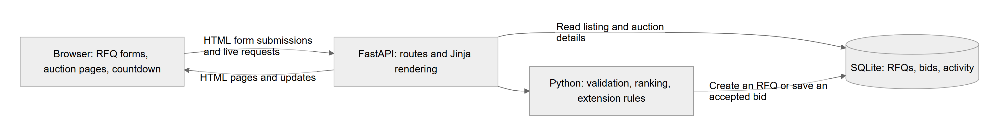

# High-level design

## Bid flow

1. FastAPI receives the quote from the form and validates its values.
2. The backend opens a SQLite write transaction, reads the RFQ and its bids, and checks that the current server time falls within the bidding period. Simultaneous bid requests take turns at this step.
3. The backend checks a returning carrier's price against its previous bid, adds the new bid, and evaluates the selected trigger if acceptance is within X minutes of the current deadline.
4. If the trigger qualifies, the new deadline is the smaller of `current deadline + Y minutes` and the forced close. The backend records the reason and both deadlines. The bid, deadline update, and log entries commit together.
5. The browser redirects after an accepted submission. Open detail pages fetch updated auction data every three seconds. The status is derived from server time and the stored deadlines.

## Data model

| Table | Contents | Relationship |
| --- | --- | --- |
| `rfqs` | RFQ name, service date, start, three closing times, and trigger settings | One RFQ has many bids |
| `bids` | Carrier, charges, total, transit days, validity, and submission time | Each bid belongs to an RFQ |
| `activity_log` | Bid and extension events, with old and new deadlines for extensions | Each event refers to the accepted bid that caused it |

## Rule decisions

- Every RFQ created by this demo is a British auction and has one extension trigger. The RFQ ID is assigned automatically.
- The initial close is strictly between the start and forced close. Bidding starts at the start timestamp and stops at the current close timestamp. A close that reaches the cap produces **Force Closed** at expiry. Other expired auctions show **Closed**.
- The trigger window starts at `current close - X minutes` inclusive. Each extension moves the window along with the deadline. Bids can still be accepted before a capped deadline, but they cannot extend it.
- Times entered and displayed use IST. The database stores deadlines and bid times as Unix seconds. Prices use INR, with amounts stored as whole paise. The bid price is the sum of freight, origin, and destination.
- The demo identifies a supplier by carrier name with case and extra spaces normalized. A revised bid must reduce that supplier's price. Rankings use each carrier's latest bid and settle ties in favor of the earlier accepted bid. Quote history keeps all accepted bids.
- A new supplier can move existing suppliers down. That counts for the rank trigger, while adding a supplier below everyone leaves the existing ranks intact. The L1 trigger fires when one existing leader is replaced by another. The first accepted bid establishes L1.
